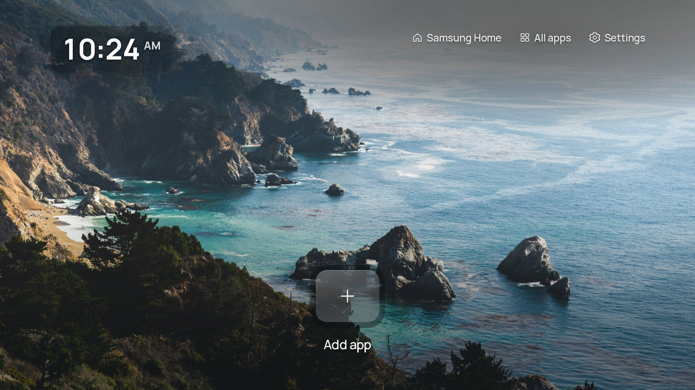

# Install and use Clean Home

**No root required.** Your existing apps stay installed, and the remote’s Home button keeps opening Samsung Home.

**[Download Clean Home](https://github.com/Dant5/clean-home-tizen/releases/tag/v1.4.1-preview.1)** and follow the steps below.

## Before you start

You need:

- A Samsung TV with **Tizen 5.0 or newer**. Developed on the **2022 Q60B**; [other models are unconfirmed](docs/COMPATIBILITY.md).
- A computer on the same home network as the TV.
- A Samsung account for the installer’s certificate setup. A certificate lets the TV accept the app.

## 1. Download Clean Home and the installer

1. Open [Clean Home Releases](https://github.com/Dant5/clean-home-tizen/releases) → **Assets**.
2. Download the file ending in **`-unsigned.wgt`**. This is the TV app; skip the source-code ZIP files. The installer will prepare it for your TV.
3. Download **Apps2Samsung** for your computer from its [official releases](https://github.com/Apps2Samsung/Apps2Samsung/releases), then open it. Choose a version with **Install a file…** support.

| Computer | Apps2Samsung download |
| --- | --- |
| Windows | The desktop **`.msi`** installer. |
| Mac | **`macos-arm64.dmg`** for Apple silicon, or **`macos-x64.dmg`** for Intel. |
| Linux | The desktop **`.AppImage`**, `.deb` or `.rpm` for your system. |

The files marked **`cli`** are for command-line use; they are not needed here.

Optional: check your download

Download `SHA256SUMS` from the same release. Check the app file using the command for your computer, replacing the filename if needed:

| Computer | Command |
| --- | --- |
| Windows PowerShell | `Get-FileHash .\CleanHome-Tizen-1.4.1-unsigned.wgt -Algorithm SHA256` |
| Mac Terminal | `shasum -a 256 CleanHome-Tizen-1.4.1-unsigned.wgt` |
| Linux Terminal | `sha256sum CleanHome-Tizen-1.4.1-unsigned.wgt` |

Compare the result with the file’s entry in `SHA256SUMS`. If they differ, download again before installing.

## 2. Find your computer’s address

You need **your computer’s local IPv4 address** for the TV’s setup.

| Computer | Where to find it |
| --- | --- |
| Windows | **Settings → Network & internet** → connected Wi-Fi/Ethernet connection → **Properties → IPv4 address**. |
| Mac | **System Settings → Network** → connected Wi-Fi/Ethernet connection → **Details → TCP/IP → IP address**. |
| Linux | Connected Wi-Fi/Ethernet connection’s **Details → IPv4 address** in network settings. |

Use the home-network connection, rather than a VPN or virtual adapter. More help: [Windows](https://support.microsoft.com/en-us/windows/experience/connectivity-networking/essential-network-settings-and-tasks-in-windows) · [Mac](https://support.apple.com/en-gb/guide/mac-help/mh14129/mac).

## 3. Enable Developer Mode on the TV

1. Open **Apps** from Samsung Home.
2. Enter **1 2 3 4 5** with the remote’s number buttons or on-screen number keypad. Some models need **Apps → App Settings** first.
3. Switch **Developer Mode** to **On**.
4. In **Host PC IP**, enter the **computer’s address from step 2**.
5. Select **OK** and restart as prompted. Reopen Apps to check Developer Mode is on.

Developer Mode allows app installation; it does not root the TV. If the window does not appear, see [Samsung’s illustrated guide](https://developer.samsung.com/smarttv/develop/getting-started/using-sdk/tv-device.html). A factory reset or service menu is not needed.

## 4. Install Clean Home

1. In **Apps2Samsung**, select your TV and wait for it to be ready. Check the model: a Samsung soundbar can also appear.
2. Choose **Install a file…** and select the Clean Home `.wgt`.
3. Follow the Samsung sign-in and certificate prompts using your own account. For an update, reuse your existing signing profile.
4. Wait for installation to succeed, then open **Clean Home** from the TV’s **Apps** screen.

You should see a photograph, clock and **+** tile. An existing installation keeps its saved apps.

## 5. Add and open your apps

1. Select **+** using the remote’s centre **OK/Enter** button.
2. Choose an installed app. Its shortcut appears, with another **+** for adding more. You can add up to **nine**.
3. Press **Select** briefly to open a shortcut.
4. To replace it, **hold Select for about one second**, release, then choose another app. **Back** cancels.

Use **Settings → Apps on Home** to reorder or remove shortcuts. To move one, select its name, use the arrows, then Select to place it. Removing a shortcut leaves the app installed.

**All apps** shows your other apps. **Settings → Background** changes the photo. **Settings → Samsung** opens TV settings and inputs.

## Home button and power-on

A standard install opens from **Apps**. It does **not** change what happens when you press Home or turn on the TV.

A separate rootless Home-button/startup setup worked on the reference Q60B. It is not included in this download. [Advanced details](docs/NATIVE-HOME.md).

## Connection and installation help

| Problem | Try this |
| --- | --- |
| Cannot find the app download | Open the preview release, expand **Assets**, then choose **`-unsigned.wgt`**. The source-code ZIP is not the TV app. |
| TV is missing | Turn it on, check both devices use the same home network, then rescan. You can also enter the TV’s address from its Network Status/IP Settings in the installer. |
| “Developer Mode is off” or TV is not ready | Repeat step 3. **Host PC IP uses the computer’s address.** Selecting the TV in the installer uses the TV’s address. |
| VPN warning or wrong network | Use the home-network address. See the installer’s network help if a VPN affects discovery. |
| No “Install a file…” option | Use a version that supports custom files; see [Apps2Samsung’s guide](https://github.com/Apps2Samsung/Apps2Samsung/wiki). |
| Certificate/signing error | Follow the installer’s certificate help. For an update, use the original signing profile and keep the installed app while fixing it. |
| Missing app or shortcut will not open | **Settings → Application IDs → Refresh installed apps**. For a hidden sideloaded app, that screen also accepts a manually verified app ID for supported services. |
| No daily photo | Choose a bundled photo in **Settings → Background**; these work offline. Check the TV’s internet connection before trying Daily photo again. |

Still stuck? [Report a problem](https://github.com/Dant5/clean-home-tizen/issues) with your TV model, software version, Clean Home version and what happened. Leave out passwords, serial numbers, certificate files and account screens.

## Updates and removal

**To update:** install the new Clean Home file using the same signing profile. This preserves saved shortcuts and settings. Keep a secure backup of that profile. An installer/certificate backup does not contain other apps’ private settings or pairings.

**To remove:** open Samsung **Apps → app settings**, select **Clean Home**, then **Delete**. Menu names vary. Only Clean Home and its saved settings are removed.

If you separately changed the Home-button/startup setup, [restore that setup first](docs/NATIVE-HOME.md), and check the physical Home button opens Samsung Home before deleting Clean Home.

Building or signing with Tizen Studio? See the [developer guide](CONTRIBUTING.md#sign-and-install-with-tizen-studio).
