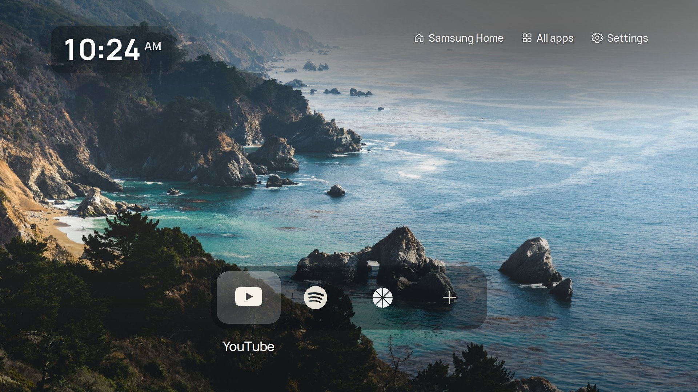
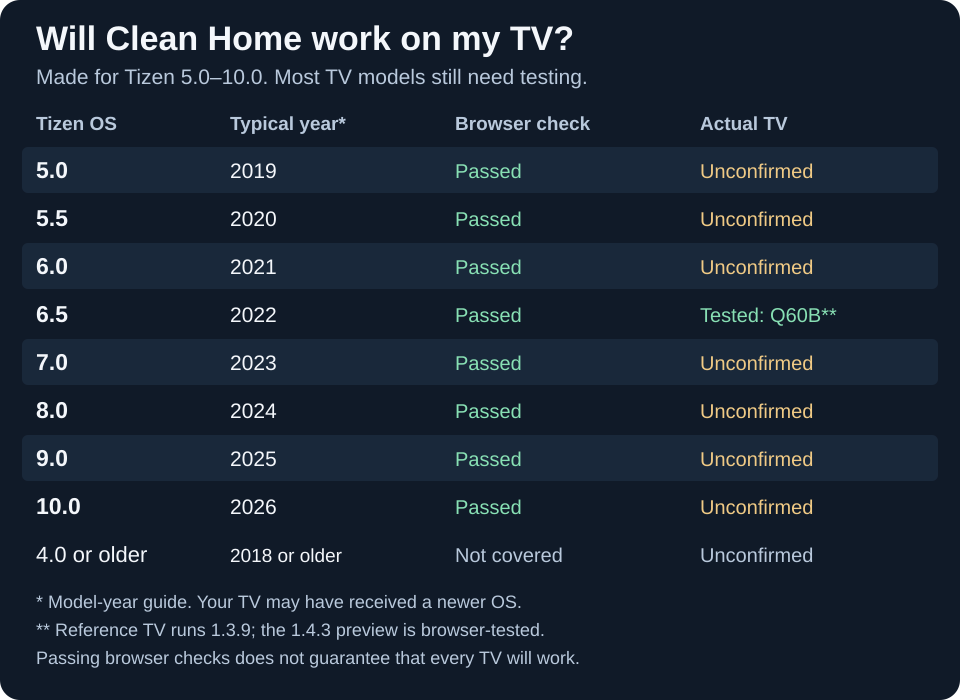

# Clean Home

### Your Home button. Your home screen.

A photo. A clock. Your favourite apps. A beautifully simple home screen.

**No root. Your apps stay installed. Samsung Home stays available.**

**[⬇ Get Clean Home Setup](https://github.com/Dant5/clean-home-tizen/releases/tag/v1.4.2-preview.2)** · [Install guide](docs/INSTALL.md) · [TV support](#tv-support)

*Your apps, your choice. A fresh install starts with a single **+**.*

## Make it your Home screen

Set up **Home and power-on to open Clean Home**. No root, no running PC and no background watcher. Samsung Home remains a button away, and **Undo** restores the original setup.

**One download, one guide:** the TV app and Home Setup tool are bundled together. Install the app with Apps2Samsung, then choose **Use Clean Home** in the setup tool.

**Home replacement is experimental and currently accepts QA55Q60BAWXXY / T-NKLBUABC-1720.7 only.** Other TVs can use Clean Home from Apps. [Home support and Undo](docs/NATIVE-HOME.md).

## What you get

- **A clean home screen** with daily photos, a clock and a glass app bar.
- **Your favourite apps**, including sideloaded apps. Pick up to nine.
- **Your settings stay yours.** Shortcuts leave existing apps, accounts and pairings alone.
- **Simple remote controls.** Arrows to move. Centre button to choose. Back to return.

## TV support

Targets **Tizen 5.0 and newer**. Our real-TV reference is a **2022 Samsung Q60B**; other models need confirmation. The layout scales to fit your screen.

**Feedback wanted!** Tried your TV? Open **Settings → Samsung → Share TV report**, review the details and press **Send**. No phone or account needed. [What gets shared](docs/TV-REPORTS.md).

## Install it

**🛠️ Difficulty: 3/10.** No coding. You need a computer on the TV’s home network and a Samsung account.

1. **Get the setup bundle.** Open [Downloads](https://github.com/Dant5/clean-home-tizen/releases/tag/v1.4.2-preview.2), choose **CleanHome-Setup-Windows-preview.zip** (or **Python** for Linux), and extract it. Open **START-HERE.html**.
2. **Install the TV app.** The guide walks through Developer Mode and [Apps2Samsung](https://github.com/Apps2Samsung/Apps2Samsung/releases). Use the included `.wgt` and your own Samsung sign-in.
3. **Make it Home.** Open the included Home Setup tool → **Check TV** → **Use Clean Home**. It saves the originals and checks compatibility before changing anything.
4. **Make it yours.** Choose **+**, then an app. Check the physical Home button and an off/on cycle. Close the setup tool when done.

Using a Mac, or just want the TV app? The same release includes the [standalone `.wgt`](docs/INSTALL.md#1-download-clean-home-setup). Home replacement currently has Windows and Linux setup builds.

**[Full step-by-step guide and fixes →](docs/INSTALL.md)**

## Use it

| Want to… | Do this |
| --- | --- |
| Add an app | Choose **+**. |
| Open an app | Press the remote’s centre **OK/Enter** button briefly. |
| Change a shortcut | Hold **OK/Enter** for about a second, release, then choose another app. |
| Reorder or remove shortcuts | **Settings → Apps on Home**. |
| See everything else | **All apps**, at the top right. |

Photos, appearance, TV settings and HDMI inputs are under **Settings**. **Back** cancels. Removing a shortcut keeps the app installed.

Why are some icons coloured?

Recognised apps use matching monochrome logos. Others use their installed icon, or initials if no icon is available. For a uniform text-only look: **Settings → Layout → App display → Text**.

## Help & credits

[Get help](https://github.com/Dant5/clean-home-tizen/issues) · [Uninstall](docs/INSTALL.md#updates-and-removal) · [Privacy](docs/PRIVACY.md)

Based on **[Clean Home by chaosmanage](https://github.com/chaosmanage/samsung-tv-launcher)**, built on Nathan Clark’s **CleanFrame**. The original look is preserved. [Full credits](docs/UPSTREAM.md) · [MIT licence](LICENSE) · [Third-party notices](docs/THIRD_PARTY_NOTICES.md).

For developers

[Build & contribute](.github/CONTRIBUTING.md) · [Test results](docs/TEST-RESULTS.md) · [Release process](docs/RELEASING.md)

