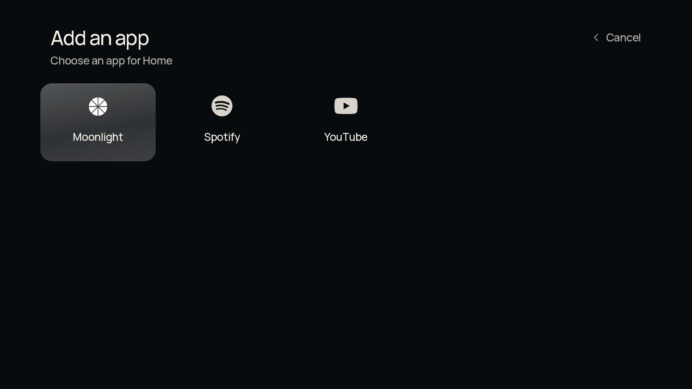

# Clean Home for Samsung TVs

A simple screen for opening your TV apps, with a photo, a clock and a glass app bar. You choose which apps appear.

**No root needed. Keep your apps. Keep Samsung Home.**

Based on [Clean Home by chaosmanage](https://github.com/chaosmanage/samsung-tv-launcher), built on Nathan Clark’s CleanFrame. The original look is preserved.

*A new installation starts with one “+” button. You add your own apps.*

## Your apps and remote

- **No root or jailbreak:** install Clean Home as a TV app.
- **Working Home button:** a standard install leaves the remote’s Home button opening Samsung Home. There is also a Samsung Home shortcut inside Clean Home.
- **Existing apps stay in place:** adding a shortcut does not reinstall the app or clear its accounts, settings or pairings.
- **Normal remote controls:** arrows to move, centre **OK/Enter** button to choose.

## TV support

Developed on a **2022 Samsung Q60B with Tizen 6.5**. Other models are unconfirmed. The layout adjusts to your screen size. [TV compatibility](docs/COMPATIBILITY.md).

## Install it

**[Download the preview](https://github.com/Dant5/clean-home-tizen/releases/tag/v1.4.0-preview.1)** · [Step-by-step installation](INSTALL.md)

You need a computer on the TV’s home network and a Samsung account. No coding is required.

1. **Download Clean Home:** open [Releases](https://github.com/Dant5/clean-home-tizen/releases) → **Assets** and choose the file ending in **`-unsigned.wgt`**. This is the TV app; skip the source-code ZIP files.
2. **Get Apps2Samsung:** download and open the installer from its [official releases](https://github.com/Apps2Samsung/Apps2Samsung/releases).
3. **Find your computer’s local IP address.** [Show me where](INSTALL.md#2-find-your-computers-address).
4. **On the TV:** open **Apps**, enter **1 2 3 4 5**, turn Developer Mode **On**, and enter the **computer’s** address as **Host PC IP**. Restart as prompted. Some models need **Apps → App Settings** first. Developer Mode is not root.
5. **In Apps2Samsung:** select your TV and wait for it to be ready. Choose **Install a file…** and select the Clean Home `.wgt`.
6. **Follow the Samsung sign-in and certificate prompts.** The installer prepares the app for your TV. Button names may vary by installer version.
7. **Open Clean Home** from the TV’s Apps screen. Choose **+**, then an installed app.

[Full step-by-step guide and common fixes →](INSTALL.md)

## Use it

“Select” means your remote’s centre **OK/Enter** button.

| To… | Do this |
| --- | --- |
| Add an app | Choose **+**, then the app. Another + remains. |
| Open an app | Press **Select** briefly on its tile. |
| Replace a shortcut | Hold **Select** for about one second, release, then choose another app. |
| Cancel | Press **Back**. |
| Reorder or remove shortcuts | **Settings → Apps on Home**. This keeps the apps installed. |
| See other apps | **All apps**, at the top right. |
| Change the photo | **Settings → Background**. Daily photos are optional. |
| Open TV settings or inputs | **Settings → Samsung**. |

Add up to nine apps. Saved favourites stay in place when updating.

See the first screen and app chooser

Example screens. Your installed apps will appear in the list.

## Home button and startup

**Installing this download does not make Clean Home open automatically at power-on or when you press Home.** A standard install keeps the usual Samsung Home behaviour; open Clean Home from Apps.

A separate setup made both work on our test Q60B, **without root**. It is specific to that TV software and **is not included in this download**. [Advanced details](docs/NATIVE-HOME.md).

## Help and credits

[Installation help and removal](INSTALL.md) · [Report a problem](https://github.com/Dant5/clean-home-tizen/issues) · [Privacy](PRIVACY.md)

[Full credits](docs/UPSTREAM.md) · [MIT licence](LICENSE) · [Third-party notices](THIRD_PARTY_NOTICES.md).

For developers: [Build and test](CONTRIBUTING.md) · [Test results](docs/TEST-RESULTS.md) · [Release process](docs/RELEASING.md).
