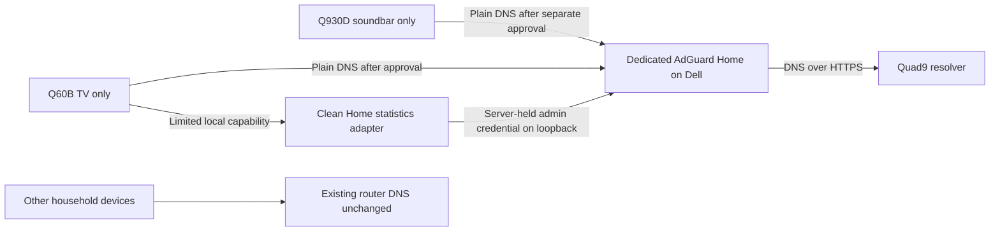
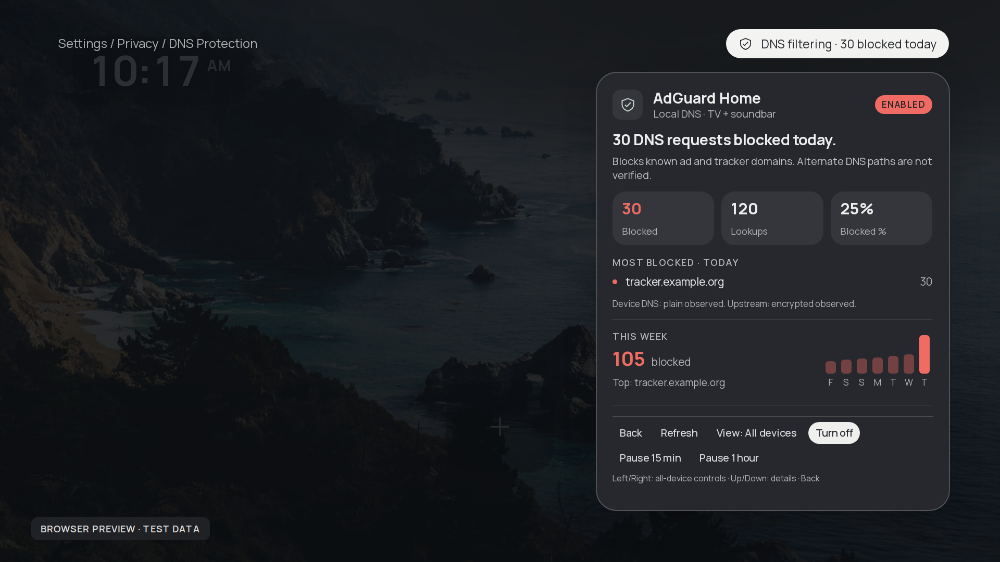

# Q60B + Q930D DNS protection

**Status: development feature on PR #20; not part of a released download.** The reference TV has separately approved 1.4.3 integration builds installed; its native Home/startup assignment and saved preferences are preserved. No newer deployment is implied by this source guide. This is an optional companion for the reference Q60B, not a new launcher or a claim of hardware qualification on other models.

## Choice: AdGuard Home on the existing server

| Option | Fit for this project |
|---|---|
| **AdGuard Home** | Local, open source, client access restrictions, maintained filter subscriptions, query logs and a documented API. One small dedicated instance can isolate this TV and soundbar without changing household DNS. Selected. |
| Pi-hole | Mature local alternative with client groups and an API. Capable, but no existing installation to reuse and no demonstrated advantage for this two-device deployment. |
| NextDNS | Useful hosted alternative with analytics and device profiles, but adds an external configuration/account dependency. The free tier has a 300,000-query monthly cap; above it queries continue without filtering. Local control is a better fit here. |
| Router-wide DNS / TV hosts modifications | A global router change would affect other devices; TV system-file changes add recovery/privilege risks. Neither is required for the first stage. |

Reviewed [AdGuard Home v0.107.80](https://github.com/AdguardTeam/AdGuardHome/releases/tag/v0.107.80), pinned by image digest in the generator. The lab observed approximately 27 MiB RAM at idle; production workload/growth still needs measurement. Existing Ubuntu DNS remains on its loopback stub. Do not disable `systemd-resolved` or replace the server's DNS configuration.



Use the router's existing DHCP service and reserve each device's current lease for its verified network-interface MAC. AdGuard identifies each protected device by its separately verified, reserved IP; MAC-based client identification would require making AdGuard the DHCP server, which we do **not** do. Wi-Fi and Ethernet MACs differ: switching interfaces requires a reviewed identity/profile update. A current matching ARP entry proves the present lease identity, not a permanent reservation.

The Q930D has its own network connection and must not be assumed to inherit the TV's DNS. [Soundbar identity, microphone findings and remaining qualification](SOUNDBAR-PRIVACY.md). Prefer per-reservation DNS if the existing router firmware actually supports it; read-only inspection confirmed that field on the reference RT-AC88U / 3.0.0.4.386_48322. Its actual DHCP option and lease behavior still need qualification after approval. Do not substitute global DNS if it is absent.

## Filtering and limits

Subscribe to [HaGeZi Light and Samsung native trackers](https://github.com/hagezi/dns-blocklists), refreshed by AdGuard every 24 hours. Light is the conservative base; the Samsung subscription adds named native ACR/advertising/telemetry endpoints. Preserve original list names/licenses; no copied list is shipped in the widget. Lists are GPL-3.0 upstream resources downloaded independently by AdGuard. Do not silently escalate to aggressive tiers or broad Smart-TV lists.

The generated allow rules protect selected Samsung update/CDN/time/certificate/account domains and major streaming content paths. Samsung QBE and application-store domains are intentionally allowed during initial qualification, even if a list marks some of them as tracking. This sacrifices some blocking to preserve functionality. No explicit firmware/update blocks, package disabling, content interception or broad Samsung parent-domain bans are included. Exceptions are precautions, **not proof every update or app path has been discovered**. Nuvio providers and Moonlight hosts vary; their actual owner configuration needs playback/pairing checks after routing is approved.

DNS cannot reliably remove YouTube video ads or ads delivered from the same domain as content. It also cannot establish that Samsung consent has been withdrawn. Private IP connections, cached DNS, alternate resolvers and encrypted DNS can bypass it. No HTTPS interception, CA installation, certificate bypass or firmware change is proposed.

Quad9 DoH is configured upstream; its public bootstrap resolvers resolve the upstream hostname. Bootstrap lookups are plain DNS. The dashboard reports **observed** query-log transport for sampled traffic, not a blanket encryption guarantee. TV-to-Dell DNS and the current local dashboard API are plaintext. No account, subscription or cloud statistics backend is needed; ordinary DNS resolution still depends on an upstream resolver.

## Visual reference

The panel/pill composition is independently implemented in Clean Home HTML/CSS/ES5 JavaScript, using Veil's [privacy screenshot](https://github.com/trbrnt/Veil/blob/9880a3f861b1e5deb35c3c43dc647e179a159f38/screenshots/04-privacy-panel-nextdns.png), [PrivacyPanel/PrivacyPill](https://github.com/trbrnt/Veil/blob/9880a3f861b1e5deb35c3c43dc647e179a159f38/source/app/src/main/java/dev/veil/launcher/ui/Components.kt) and [NextDnsStats](https://github.com/trbrnt/Veil/blob/9880a3f861b1e5deb35c3c43dc647e179a159f38/source/app/src/main/java/dev/veil/launcher/data/NextDnsStats.kt) as research references. No Kotlin, Android permissions, API keys, screenshots or graphics are incorporated. Veil is GPL-3.0; the reference is credited in the notices.

The original Clean Home stays beneath a dimmed overlay, with a compact right-hand panel, status pill, counters, short domain list and small weekly chart. The visual treatment does not carry over claims that every lookup is encrypted or every tracker stopped. Our calendar-day statistics, unavailable states, server-held administration and two-device attribution use our own backend.



*Visual preview only. These counters are test data, not measured owner-device activity.*

## Dashboard and trust boundary

**Settings → Privacy → DNS Protection** uses the existing Clean Home typography, panels, focus and Back handling. Combined totals are the default. The **View: All devices / TV / Soundbar** control switches attribution locally without requesting another household client. Missing soundbar configuration is shown as not connected, not as zero activity. Protection controls explicitly apply to both configured devices. No homepage polling or new animated rendering. Left/Right selects controls; Up/Down scrolls details. Turn off asks for confirmation; pauses resume in AdGuard without needing Clean Home open. A paused/disabled filter still requires the Dell for DNS.

The widget receives only the companion endpoint and a random capability limited to the configured TV/soundbar statistics and their dedicated protection switch. It never receives AdGuard's administrator password. The companion offers no generic API proxy, rule editor, shell, native helper or caller-selected client. Status and every control check the dedicated resolver's exact TV/soundbar allowlist; drift locks controls. The administration listener is loopback-only. CORS/Host/source-address checks and JSON-only commands reject ordinary cross-site requests; source IP alone is not an anti-spoofing guarantee on an untrusted LAN.

Counts are from available, exact-client query-log records, combined by summing counts before calculating the percentage in the configured timezone, not global rolling 24-hour statistics. The chart covers seven calendar days of available history. It labels partial record limits and missing history; zero recorded queries does not prove zero network activity. Unreachable/error/suspended results become unknown, rather than retaining a green protection claim. Blocked domains are private to this local page and are never attached to public TV reports.

## Prepare without changing live DNS

1. Record the installed widget identity, original network settings and router lease privately. Preserve the existing signed 1.3.9 recovery widget, author identity, favourites and native originals. No reinstall is needed to test DNS filtering.
2. Create owner-only files containing a new AdGuard password and its bcrypt hash. Use an established bcrypt implementation/password utility; never put a password in a command argument or Git. These are different from the limited TV capability generated below.
3. Generate a private profile; placeholders below must be supplied explicitly. Keep it under ignored `.local/` for testing or the approved private deployment directory later.

```sh
python3 tools/dns-protection/prepare.py \
  --tv-ip "$TV_IP" --soundbar-ip "$SOUNDBAR_IP" --server-ip "$SERVER_LAN_IP" \
  --timezone "$LOCAL_TIMEZONE" \
  --admin-hash-file "$PRIVATE_HASH_FILE" \
  --admin-password-file "$PRIVATE_PASSWORD_FILE" \
  --output "$NEW_PRIVATE_PROFILE"
```

For a disposable loopback test, use TV client `127.0.0.2`, soundbar client `127.0.0.3`, server `127.0.0.1` and `--test`. Omit `--soundbar-ip` only for a staged TV-only trial; the dashboard will mark the soundbar unconfigured. Only that mode uses DNS port 15353. A production profile uses the server's specific LAN IP on TCP/UDP 53, not all interfaces. Admin stays at `127.0.0.1:13080`. The dashboard adapter uses port 8768. Profiles/secrets are 0600, directories 0700. Do not print `docker compose config` output or profile contents into a public log.

4. Validate/start only the isolated lab with its private environment file, explicit Compose project and `tools/dns-protection/compose.yaml`. Run `scripts/check-dns-lab.py`. It tests real upstream DNS, deny-by-client, UDP/TCP blocking, preservation rules, actual pause/readback and attribution. `scripts/check-dns-restore.py` rehearses a stopped-writer copy and isolated restored application startup on different loopback ports. Neither script targets the TV.
5. For a future private widget build, use `python3 scripts/package.py --dns-profile-json "$PRIVATE_PROFILE/widget.json"` plus the existing external owner signing workflow. Only this private artifact gets the single backend network permission and limited capability. It is **not a public release artifact**. The generic widget remains disconnected by default, with unchanged privileges and application identity.

## Commissioning — approval required before live changes

The owner must approve the exact per-device DNS / DHCP reservation proposal first. Do not treat source approval, an allowed remote-control connection or a previous launcher installation as DNS-routing approval.

1. Protect the affected configuration and confirm the existing encrypted Hubert recovery copy, current backup payload/repository limits and free space. Enroll this service before persistent activation (below).
2. Install the dedicated resolver with explicit persistent `conf/` and `work/` mounts. Apply the production restart override only after recovery/monitoring enrollment. Pin the reviewed digest; manual reviewed upgrades only. Host networking preserves the original DNS client address, but bind addresses, capabilities and actual listeners must be checked. DHCP, encrypted inbound DNS and installer UI remain disabled. Check localhost admin auth before any TV routing.
3. Install the adapter's hardened service template with a dedicated non-login account, read-only code under `/opt/cleanhome-privacy`, and owner-only secret configuration under `/etc/cleanhome-privacy`. Set the private bind/TV IP profile explicitly. No root execution or Docker socket in the adapter. Do not deploy a second proxy, monitor or scheduler.
4. In the existing router, reserve **only the verified TV and soundbar interfaces' current leases**, if not already reserved. Save each original reservation state privately. If this exact router firmware offers per-entry **DNS Server (Optional)**, propose setting it to the Dell for only those two entries, leaving all other entries/global fields unchanged. Verify DHCP option 6 and actual source-IP log attribution after renewal. The field was read back on the reference RT-AC88U / 3.0.0.4.386_48322; that does not prove the devices have adopted its DNS value. Do not change router WAN/LAN/DHCP-wide DNS, IPv6, Wi-Fi or firewall policies. On the reference firmware, the normal form uses `restart_net_and_phy` with a 30-second wait, which can briefly interrupt household LAN/Wi-Fi. Obtain approval for that wider interruption before applying; do not describe it as affecting only the two clients.
5. If per-entry DHCP DNS is unsuitable, on the TV change **DNS only** to the Dell's LAN IP through Samsung's normal IP settings, preserving address/subnet/gateway. Capture the original automatic/manual setting and resolver list first. Read the resulting `/etc/resolv.conf` and confirm the TV's own new DNS requests appear under the exact dedicated client. Audit previously observed secondary DNS explicitly; one successful query is not full coverage.
For the soundbar, use only a verified supported per-device DNS mechanism. Its local API has not established a DNS setter. If the router lacks per-device DNS, stop that routing stage and propose another reversible device-only route; do not change household DNS or install router firmware.
6. Run the bounded client/function/coverage checks below. Revert immediately if normal TV functionality fails and pause does not recover it. Do not block update checks or flash firmware during validation.
7. Installing a newer Clean Home dashboard is a separate approved step, preserving the package/signing identity and preferences. Do not rerun native Home setup. Keep the installed 1.3.9 recovery artifact and private endpoint out of releases.

### Existing infrastructure enrollment, before activation

Use the existing Restic/Hubert jobs and exception-only Kuma/host checks. No extra backup/alert timer:

- Explicitly protect the complete private profile (`conf`, `work`, admin/capability settings, Compose/environment), adapter configuration/code and installed service unit. Automatic mount discovery alone does not enroll a new container.
- Add the resolver/profile to the existing `cold_copy_containers` mapping and selected backup sources. Give its data a separate selected root (for example `/var/lib/cleanhome-dns`) so capturing a much larger parent directory does not hold DNS stopped throughout that parent’s backup. Stop only this resolver for a consistent complete capture and use the existing persisted-intent/finally/restart recovery path. Its query-log and statistics files must not be copied as if a generic live-file snapshot were consistent. Brief DNS unavailability during the daily capture must be measured; choose a safe retry window rather than hiding an unfiltered fallback. The stateless adapter needs only code/config backup.
- Query logs contain browsing/service metadata. Live rotation is seven days per log interval (a previous rotation may remain); encrypted retained snapshots can keep older records under the server's existing no-prune policy. State this retention honestly; do not silently exclude query data or delete snapshots to shorten it.
- Existing 5 GB payload and encrypted-repository limits stay unchanged. Review measured initial size, seven distinct days of growth and a 90-day budget before unattended use. The lab's small size is not a production estimate. Keep the existing staging/reserve checks; do not activate if protected scope cannot fit.
- The adapter's `/health` returns JSON `status: UP` only after authenticated AdGuard scope/log/filter checks. It returns 503 on drift/down. Permit health only from the server itself. Enroll this URL in existing host `application_health_urls` under an existing alert category, or a single existing Kuma HTTP check with a meaningful response condition. Verify failure/recovery without sending success notifications. DNS traffic itself must also pass a commissioning probe; API health alone cannot prove UDP/TCP routing.
- Add the resolver to existing essential-container coverage and the adapter to the existing failed-unit checks. Add the pinned AdGuard release to silent metadata awareness; no auto-updater. Record versions, paths, listeners, measured capacity, recovery evidence and rollback in the local infrastructure register.

## Reference trial results

The owner-approved Q60B/Q930D trial is active on the development server. Final authenticated router readback confirmed exactly the intended two reservations, the original reservation and all global DHCP/DNS fields unchanged. Independently attributed requests from both devices and actual TV blocks were observed. Two other household clients retained their original normal DNS and were rejected by the dedicated resolver; no household-wide DNS change was made. These checks qualify that specific trial, not all network clients or every TV function.

The TV adopted the dedicated resolver as primary but still lists a Google secondary. Hardcoded/encrypted escape paths and actual fallback frequency remain unverified. Keep the dashboard coverage warning; do not infer complete protection from block counts. A future enforcement change requires a separate exact proposal and approval.

The limited adapter, native pause/resume and encrypted off-machine recovery were tested. The newer dashboard widget remains uninstalled. Streaming/DRM, SmartThings, eARC/Q-Symphony, microphone/assistant state, update connectivity and seven days of actual storage growth remain commissioning checks. No root, app removal, firmware change or Home reassignment occurred. Private identities, query logs and recovery evidence stay outside Git.

## Client verification and bypass assessment

| Test | Required evidence |
|---|---|
| Stable identity | Current TV and soundbar lease/MAC match private baselines; actual reservation readback (not just ARP) |
| TV/soundbar-only scope | AdGuard exact protected-client pair; another LAN device querying it is denied; no household/global DNS changed |
| Other-device control | Dell and a second household device resolve normally through their original DNS; no new filter logs for other devices |
| Blocking | Separately attributed TV- and soundbar-origin lookups to maintained-list ad/ACR canaries are blocked; useful hosts resolve; recent log attribution matches |
| Secondary DNS | Post-change resolver list, repeated requests and a brief **approved** resolver-unavailable test; record any fallback |
| Hardcoded plain DNS | Bounded router-side/per-TV capture or counters for TCP/UDP 53 to destinations other than Dell; Dell-only capture cannot see all switched TV traffic |
| Encrypted bypass | Per-TV 853 and relevant 443 destinations / app behavior; 443 alone does not identify DoH, and absence in a short sample is not proof none exists |
| Functionality | Netflix/Nuvio/YouTube streaming, Spotify, Moonlight pairing/stream, Samsung account/store, Home/Back, standby/wake, Q-Symphony, HDMI eARC, rear/sub audio, SmartThings control and casting; normal update-check connectivity without installing firmware |
| Recovery | Pause/resume, explicit off/on, server/adapter restart and reverting TV DNS to its original setting |

Do not add router DNS interception, firewall rules or disable encrypted DNS as an automatic response. If bypass occurs, present an exact TV-only enforcement proposal and its rollback for fresh approval. Keep the UI's coverage warning until evidence supports a narrower, dated statement. No filtering statistic proves all tracking prevented.

## Owner-local recovery without updating the TV app

A server owner with the private profile can control the dedicated instance locally, before the dashboard is installed:

```sh
python3 tools/dns-protection/bridge.py --config "$PRIVATE_PROFILE/bridge.json" --action status
python3 tools/dns-protection/bridge.py --config "$PRIVATE_PROFILE/bridge.json" --action pause15
python3 tools/dns-protection/bridge.py --config "$PRIVATE_PROFILE/bridge.json" --action enable
```

Other fixed actions are `pause60` and `disable`. This mode starts no listener and exposes no administrator password. It uses the same fresh device-scope guard and readback as the dashboard. Pausing only disables filtering; it does not restore connectivity if the DNS server itself is unavailable.

## Recovery

1. If a service breaks, **Pause 15 min** on the Privacy page. The native AdGuard pause expiry resumes blocking even if Clean Home closes. Test the same app again.
2. If the Dell/resolver is unreachable, pausing cannot fix DNS availability: use Samsung **Settings → General / Connection → Network → Network Status → IP Settings → DNS setting**, restore the privately recorded original automatic/manual TV setting, and reconnect if prompted. Menu wording varies. This restores the previous network behavior without uninstalling Clean Home or touching its Home assignment.
3. Restore the soundbar's per-entry DHCP DNS and any added device reservations to their saved originals, renew only its lease/reconnect Wi-Fi if needed, then verify SmartThings/audio. For TV rollback restore its own DNS/reservation likewise; never rewrite the whole router configuration to undo one entry.
4. After the TV no longer depends on the resolver, stop/disable only the new adapter and dedicated Compose project. Preserve private profiles/recovery snapshots. Restore original image plus stopped-writer data for a failed upgrade; never point an older binary at newer migrated state.
5. Revert the widget to the retained same-author owner build only under separate installation approval. Other apps and their private settings are never overwritten by this companion.

## Primary references

[AdGuard Home configuration](https://adguard-dns.io/kb/adguard-home/configuration/), [client identification and per-client rules](https://adguard-dns.io/kb/adguard-home/clients/), [pinned API schema](https://github.com/AdguardTeam/AdGuardHome/blob/v0.107.80/openapi/openapi.yaml), [DNS limitations](https://adguard-dns.io/kb/adguard-home/faq/#are-there-any-known-limitations), [HaGeZi lists and licensing](https://github.com/hagezi/dns-blocklists), [NextDNS pricing/cap behavior](https://nextdns.io/pricing), [Pi-hole client groups](https://docs.pi-hole.net/group_management/groups/), [ASUS per-reservation DNS guidance](https://www.asus.com/us/support/faq/1000906/).

## Dashboard count meanings

**Blocked today** counts refused DNS lookups for the selected device(s), using the configured calendar day. **Lookups today** counts all recorded requests, including those refused and repeated requests. Neither is a count of individual adverts.

The **Lifetime blocked** counter seeds from available real query-log history when enabled, including today and previous retained days, then accumulates persistently. It persists across adapter restarts and log expiry, stores no domain history and is included in the explicitly enrolled private state/backup scope when deployed. Missing earlier activity is not invented. Missing or partial history is labelled ≥; an unavailable/unconfigured counter shows an em dash. The existing adapter collects counts every five minutes while enabled, including when the dashboard is closed, without another service or system timer. See [optional counter setup and limitations](../tools/dns-protection/README.md#optional-dashboard-counters-manual-commissioning).

Optional router packet counts are separate: **External DNS packets blocked** is a timestamped TV-only snapshot of the audited UDP/TCP port-53 DROP counters. All resolver destinations are included. Counters reset after router/firewall restarts, include retries/test packets and are never added to daily or lifetime DNS lookup totals. Their presence does not rule out encrypted DNS. The dashboard service receives only sanitised data, never router administrator credentials or key access. The counter UI and companion have been deployed with owner approval on the reference Q60B; other models remain unqualified.
